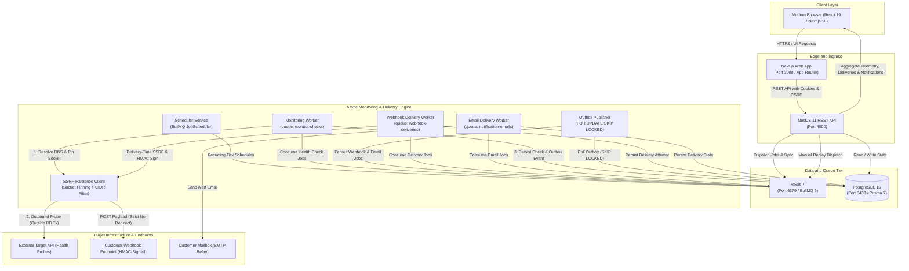

# DevPulse — High-Precision API Uptime Monitoring & Incident Management Platform

[](https://github.com/alihasnain92/devpulse/actions/workflows/ci.yml)
[](https://nodejs.org/)
[](https://pnpm.io/)
[](https://www.postgresql.org/)
[](https://redis.io/)
[](https://nextjs.org/)
[](https://nestjs.com/)
[](https://www.prisma.io/)

**DevPulse** is an enterprise-grade full-stack SaaS platform engineered for continuous API uptime monitoring, real-time telemetry analysis, and automated incident lifecycle management. Built with a modern TypeScript monorepo architecture, DevPulse demonstrates resilient backend design, robust security practices (including defense-in-depth SSRF mitigation), and reactive dashboard visualization.

---

## Architecture Overview

DevPulse decouples the web application, REST API, and asynchronous monitoring engine to guarantee high throughput, fault tolerance, and zero connection exhaustion.



---

## Monorepo Layout

DevPulse is organized as a high-performance **pnpm workspace**:

```
devpulse/
├── apps/
│   ├── web/                    # Next.js 16 App Router (React 19, Tailwind CSS 4, shadcn/ui, Recharts)
│   └── api/                    # NestJS 11 REST API & Standalone BullMQ Worker
├── packages/
│   └── shared/                 # Shared TypeScript DTOs, API contracts, enums, and validation constants
├── prisma/
│   ├── migrations/             # Timestamped, version-controlled PostgreSQL migrations
│   ├── schema.prisma           # Prisma 7 database schema definitions
│   └── seed.ts                 # Safe, idempotent demonstration data seeder
├── .github/
│   └── workflows/
│       └── ci.yml              # GitHub Actions CI (linting, tests, build, seed validation)
├── docker-compose.yml          # Containerized PostgreSQL 16 and Redis 7 orchestration
├── prisma.config.ts            # Prisma 7 CLI configuration & migration runner
├── pnpm-workspace.yaml         # Workspace package declarations
└── package.json                # Root orchestration scripts and dev toolchain
```

---

## Technology Stack

| Layer | Technologies |
|---|---|
| **Frontend** | [Next.js 16](https://nextjs.org/) (App Router), [React 19](https://react.dev/), [Tailwind CSS 4](https://tailwindcss.com/), [shadcn/ui](https://ui.shadcn.com/), [Recharts](https://recharts.org/), [Lucide React](https://lucide.dev/) |
| **Backend API** | [NestJS 11](https://nestjs.com/), [Express](https://expressjs.com/), [TypeScript 5](https://www.typescriptlang.org/), [class-validator](https://github.com/typestack/class-validator) |
| **Asynchronous Engine**| [BullMQ 6](https://bullmq.io/), [Redis 7](https://redis.io/) (Dedicated Worker process isolated from API process) |
| **Persistence & ORM** | [PostgreSQL 16](https://www.postgresql.org/), [Prisma 7](https://www.prisma.io/) with `@prisma/adapter-pg` driver adapter |
| **Authentication** | Dual-token JWT (Access in 15m HttpOnly cookie, Refresh in 7d HttpOnly cookie), Cryptographic Token Rotation, Family Revocation |
| **Security Controls** | Multi-tier SSRF guard with socket-level IP pinning, RFC 1918 & Cloud Metadata CIDR blocklist, custom CSRF header validation |

---

## Key Features & Production Engineering

### 1. Hardened SSRF Defense & Socket Pinning
Outbound health-check requests are executed via a custom `MonitoringHttpClientService` that prevents Server-Side Request Forgery (SSRF) and DNS rebinding attacks:
- **Pre-Resolution Validation**: Hostnames are resolved via Node DNS before connection. Private, loopback, link-local, multicast, and cloud metadata addresses (`169.254.169.254`, `127.0.0.0/8`, `10.0.0.0/8`, `172.16.0.0/12`, `192.168.0.0/16`, `::1`) are immediately blocked.
- **Socket-Level Connection Pinning**: Custom agent creates direct TCP sockets pinned strictly to the validated IP address, neutralizing Time-of-Check to Time-of-Use (TOCTOU) DNS rebinding vulnerabilities.
- **Resource Constraints**: Maximum response body size cap (100 KB) and strict connection timeouts (1–30s) prevent memory exhaustion or worker hanging.
- **Strict Redirect Control**: Redirect chains are re-validated through the entire SSRF filter pipeline.

### 2. Transaction Boundaries & Non-Blocking Probes
Database connections are protected against exhaustion:
- **Zero Network Locks**: Outbound HTTP checks execute entirely outside PostgreSQL transactions. The database connection is never held open while waiting on third-party API response latency.
- **Micro-Transactions**: Persistence of `CheckResult` and evaluation of incident states execute in brief, atomic transactions with explicit row locking (`SELECT ... FOR UPDATE`) solely during database state mutation.
- **Timestamp Ordering Enforcement**: Probes record `checkedAt` before the HTTP request begins, ensuring slow checks cannot resolve incidents created after probe dispatch.

### 3. Automated Incident State Machine
- **Consecutive Failure Threshold**: An incident is automatically triggered only after **3 consecutive failed checks**, eliminating transient noise and false positives.
- **Immediate Recovery**: The very first successful health check automatically transitions an active incident to `resolved` and stamps `resolvedAt`.
- **Database-Level Deduping**: A PostgreSQL partial unique index `(monitor_id) WHERE is_resolved = false` guarantees that concurrent worker jobs can never create duplicate active incidents for the same monitor.
- **Credential Redaction**: Outbound probe failure logs sanitize tokens, JWTs, credentials, and cookies before persistence.

### 4. Metrics & Statistical Telemetry
- **Flexible Time Windows**: Computes aggregated statistics across **24 Hours**, **7 Days**, and **30 Days**.
- **Percentile Latency**: Calculates p50, p95, and p99 response times using nearest-rank statistical formulas across successful health probes.
- **Time-Series Aggregation**: Bins telemetry into hourly buckets (24h) and daily buckets (7d/30d) for interactive Recharts visualizations.

### 5. Demo Data Policy & Strict Telemetry Boundary
- **Isolated Synthetic Telemetry**: Includes a deterministic seeder (`pnpm db:seed`) generating 4 realistic monitors, 1,776 historical checks, and 2 resolved incidents under a dedicated demo account.
- **Clean Telemetry Separation**: Synthetic records marked `isSeeded: true` are strictly isolated to the showcase user (`demo@devpulse.dev`). Real user accounts calculate metrics exclusively from authentic outbound probes, preventing synthetic contamination even under manual query manipulation.

### 6. Webhook Registration & Cryptographic Signatures (Level 2, Phase 7)
- **Endpoint Configuration**: Each webhook endpoint contains a human-readable identifier (`name`, 1–100 characters, trimmed), destination URL, optional context (`description`, up to 255 characters), event subscriptions (`events`), active status toggle (`isEnabled`), and a one-time signing secret (`whsec_...`).
- **Granular Event Subscriptions**: Supports endpoint registration for `incident.created` and `incident.resolved` events with user-scoped isolation and active/disabled toggle.
- **Static SSRF Validation**: Rejects invalid protocols, private subnets (RFC 1918), loopback, link-local, and cloud metadata addresses statically at registration time without initiating network lookups.
- **Cryptographic Secret Storage**: Signing secrets are generated as `whsec_` prefixed 256-bit entropy keys, encrypted at rest via AES-256-GCM using `WEBHOOK_ENCRYPTION_KEY` with randomized 12-byte initialization vectors and 16-byte authentication tags.
- **Versioned HMAC Signatures**: Outbound signatures follow the standard `x-devpulse-signature: t=${timestamp},v1=${signature}` specification, calculated as `HMAC-SHA256("${timestamp}.${payload}", secret)` with constant-time equality checks and a 300-second replay tolerance window.
- **Zero Secret Exposure**: Secrets are revealed strictly once in the creation modal; all subsequent read, list, and update responses omit the secret entirely.

### 7. Scoped API Keys & Programmatic Access (Level 2, Phase 7)
- **High-Entropy Keys**: Programmatic keys formatted as `dp_live_` + 40-character random base62/alphanumeric tokens (~240 bits entropy).
- **One-Way SHA-256 Hashing**: Secret key tokens are never stored plaintext. Only their SHA-256 hash (`keyHash`) and a 16-character non-secret display prefix (`dp_live_abcd...`) are persisted.
- **Additive Dual-Mode Authentication**: Endpoints accept either ambient session cookies or programmatic API keys via `x-api-key: dp_live_...` or `Authorization: Bearer dp_live_...`.
- **Explicit Least-Privilege Scoping**: Granular scope enforcement (`monitors:read`, `monitors:write`, `incidents:read`, `webhooks:read`, `webhooks:write`) via `@RequireScopes()` decorators and global guard evaluation.
- **Automated CSRF Exemption**: Programmatic API key requests without ambient browser session cookies are exempt from CSRF checks while retaining strict origin/cookie security for browser clients.
- **Usage Auditing**: Automatically records asynchronous `lastUsedAt` timestamps on each successful invocation without delaying request latency.

### 8. Reliable Webhook Event Delivery Pipeline (Level 2, Phase 8)
- **Transactional Outbox Architecture**: Durable transactional event capture with automatic outbox recovery and at-least-once webhook delivery. During incident transitions (`incident.created` and `incident.resolved`), `WebhookEvent` and `WebhookOutbox` records are persisted atomically inside the incident transaction. Zero network or queue I/O occurs within the database transaction.
- **Recoverable Leases & Crash Window Resolution**:
  - *Outbox Crash Before Enqueue*: Outbox rows are claimed with a bounded 60-second lease timestamp (`claimedAt`). If a publisher process crashes while an outbox record is marked `PROCESSING`, subsequent polling ticks or worker restarts automatically reclaim stale rows (`claimedAt <= NOW() - 60s`) without human intervention.
  - *Outbox Crash After Queue Enqueue*: Delivery rows are uniquely indexed on `(eventId, endpointId)` and enqueued to BullMQ using deterministic job IDs (`webhook-delivery:${deliveryId}`). On recovery, existing jobs in Redis or completed delivery states are reconciled cleanly, safely completing outbox records without duplicate deliveries.
  - *Crash During HTTP Dispatch*: A durable `WebhookAttempt` record is persisted in `STARTED` status **before** the network request begins. If the worker crashes mid-flight, the outcome remains unknown; on recovery, the interrupted attempt is marked `ABANDONED` (retained for auditing) and a new attempt number is atomically allocated via PostgreSQL `SELECT ... FOR UPDATE` row locks.
  - *Stale Delivery Recovery*: Deliveries stuck in `PROCESSING` past a 120-second lease (`claimedAt <= NOW() - 120s`) are automatically detected and recovered by the publisher poller.
- **Durable Event Deduplication**: Events carry deterministic deduplication keys (`incident.created:<incidentId>`, `incident.resolved:<incidentId>`) backed by a PostgreSQL unique constraint on `(tenant_id, deduplication_key)`.
- **Concurrent Fanout Publisher**: The standalone `WebhookOutboxPublisherService` continuously polls pending and stale outbox rows using `SELECT ... FOR UPDATE SKIP LOCKED` bounded batches. It resolves matching subscribed endpoints, reconciles existing delivery state, enqueues missing BullMQ jobs, and marks outbox items as `COMPLETED`.
- **Delivery-Time SSRF & Socket Pinning**: Webhook destination URLs undergo fresh DNS resolution and CIDR validation at dispatch time via `WebhookHttpClientService`. Pinned TCP sockets enforce connections strictly to the validated IP, eliminating Time-of-Check to Time-of-Use (TOCTOU) DNS rebinding attacks.
- **Strict No-Redirect Policy**: Outbound delivery treats HTTP 3xx responses (301, 302, 307, 308) strictly as delivery failures. Redirects are never followed, completely eliminating SSRF redirect pivots to internal cloud services.
- **Versioned HMAC-SHA256 Signatures**: Each outbound HTTP POST request is signed in memory and delivers standardized enterprise headers:
  - `Content-Type: application/json`
  - `User-Agent: DevPulse-Webhook/1.0`
  - `X-DevPulse-Event-Id: <uuid>`
  - `X-DevPulse-Delivery-Id: <uuid>`
  - `X-DevPulse-Event-Type: incident.created | incident.resolved`
  - `X-DevPulse-Timestamp: <epoch_seconds>`
  - `X-DevPulse-Signature: t=${epoch_seconds},v1=${hmac_sha256}`
- **At-Least-Once Delivery Semantics**: Delivery is guaranteed at least once across transient network partitions and worker restarts. Receivers should deduplicate inbound requests by caching the immutable `X-DevPulse-Event-Id`. Exactly-once HTTP delivery is not claimed or possible over unreliable networks.
- **Exponential Backoff & Smart Retries**:
  - Maximum of 6 attempts total (initial attempt + 5 retries).
  - Delay schedule: attempt 2 (~30s), attempt 3 (~2m), attempt 4 (~8m), attempt 5 (~32m), attempt 6 (~2h).
  - Bounded randomized jitter (10–25%) prevents thundering herd retry spikes on external webhook receivers.
  - **Permanent Failure Classification**: Client errors (HTTP 4xx except 408/429) immediately terminate retries, setting delivery status to `FAILED`.
  - **Transient Failure Classification**: Server errors (HTTP 5xx), timeouts (408), rate limits (429), and network errors trigger automatic exponential backoff.
- **Durable Attempt History**: Every dispatch attempt persists a `WebhookAttempt` row recording the attempt number, latency in milliseconds, HTTP status code, sanitized error details, and a capped 1 KB response preview (`responseBodyPreview`).
- **Worker Health Diagnostics**: The REST API exposes `GET /health/worker`, reporting operational diagnostics for both `monitorWorker` (queue `monitor-checks`), `webhookWorker` (queue `webhook-deliveries`), and shared `redis` connectivity.

### 9. Webhook Delivery History, Attempt Inspection & Manual Replay (Level 2, Phase 9)
- **Immutable Historical Snapshots**: Every `WebhookDelivery` records an immutable snapshot of destination details (`endpointName`, `destinationUrl`) captured at dispatch time, ensuring delivery records remain accurate even if endpoint names, URLs, or secrets are subsequently modified.
- **Soft-Deletion Endpoint Preservation**: Webhook endpoints support soft deletion (`deletedAt TIMESTAMP(3)`). Deleting an endpoint removes it from active event fanout without deleting associated historical delivery logs or attempt records (`ON DELETE RESTRICT` foreign key integrity).
- **Deep Delivery & Attempt Inspection**:
  - Full delivery detail inspection exposing snapshot routing compared to live endpoint state (highlighting deleted or disabled endpoints or updated URLs).
  - Chronological attempt timeline with statuses (`STARTED`, `SUCCESS`, `FAILED`, `ABANDONED`), execution latency in milliseconds, HTTP response codes, classified error codes, and bounded response previews (1 KB max).
  - Safe payload inspection with formatted JSON display and single-click clipboard copying (cryptographic secrets and internal IPs are never leaked).
- **Lineage-Tracked Manual Replay**:
  - Operators can manually trigger re-dispatch of historical webhook events via `POST /webhooks/deliveries/:id/replay`.
  - Creates a new `WebhookDelivery` record with `origin: MANUAL_REPLAY`, referencing the parent delivery via `replayOfId`.
  - Snapshots current live endpoint state, reuses exact original `WebhookEvent.payload`, re-validates delivery-time SSRF, generates fresh HMAC-SHA256 signature (`t=now`), preserves `X-DevPulse-Event-Id`, and assigns a new `X-DevPulse-Delivery-Id`.
- **Replay Idempotency & Concurrency Safety**:
  - Manual replays require an `Idempotency-Key` header with tenant-scoped deduplication (`replay:<userId>:<key>`). Duplicate requests safely return the already-enqueued delivery record without creating duplicate dispatch jobs.
  - Automatic delivery uniqueness is enforced via a PostgreSQL partial unique index:
    `CREATE UNIQUE INDEX "webhook_deliveries_automatic_unique" ON "webhook_deliveries"("eventId", "endpointId") WHERE ("origin" = 'AUTOMATIC');`
    allowing unlimited intentional manual replays while preventing automatic fanout duplication.
- **Receiver-Side Idempotency Best Practices**:
  - Webhook delivery operates with **at-least-once** semantics across distributed systems and retries.
  - Consumers must deduplicate incoming webhooks by recording the immutable `X-DevPulse-Event-Id` header rather than treating HTTP delivery as exactly-once.

---

## Showcase Quick Start

### 1. Prerequisites
Ensure you have the following installed on your machine:
- [Node.js](https://nodejs.org/) (v22.x or v24.x)
- [pnpm](https://pnpm.io/) (v10.x or v12.x)
- [Docker](https://www.docker.com/) & Docker Compose

### 2. Clone & Install
```bash
git clone https://github.com/alihasnain92/devpulse.git
cd devpulse
pnpm install
```

### 3. Configure Environment Variables
Copy `.env.example` to `.env`:
```bash
cp .env.example .env
```
*(On Windows PowerShell: `Copy-Item .env.example .env`)*

> [!NOTE]
> `.env.example` provides default development values, including `WEBHOOK_ENCRYPTION_KEY` (a 32-byte hex string used for AES-256-GCM encryption of webhook signing secrets). For production deployments, generate a unique key using `node -e "console.log(require('crypto').randomBytes(32).toString('hex'))"`.

### 4. Start Infrastructure Containers
Start PostgreSQL 16 (port 5433) and Redis 7 (port 6379):
```bash
pnpm dev:services
```

### 5. Apply Database Migrations & Seed Demo Data
```bash
pnpm db:migrate
pnpm db:seed
```

### 6. Start the DevPulse Application
Start the Web App, REST API, and Background Worker concurrently:
```bash
pnpm dev
```

### 7. Access DevPulse
- **Web Dashboard**: [http://localhost:3000](http://localhost:3000)
- **REST API & Health**: [http://localhost:4000/health](http://localhost:4000/health)

#### Showcase Demo Credentials
Click the **"Fill Demo Credentials"** button on the login screen or enter:
- **Email**: `demo@devpulse.dev`
- **Password**: `Password123!`

---

## Monorepo Command Reference

| Command | Description |
|---|---|
| `pnpm dev` | Starts Next.js (3000), NestJS API (4000), and Worker concurrently |
| `pnpm dev:web` | Starts Next.js 16 frontend in development mode |
| `pnpm dev:api` | Starts NestJS 11 API server in watch mode |
| `pnpm dev:worker` | Starts the standalone BullMQ monitoring worker process |
| `pnpm dev:services` | Starts PostgreSQL 16 and Redis 7 via Docker Compose |
| `pnpm dev:services:down` | Gracefully terminates Docker containers |
| `pnpm db:generate` | Generates the Prisma 7 client |
| `pnpm db:migrate` | Runs Prisma migrations in development |
| `pnpm db:seed` | Seeds idempotent demo monitors, telemetry, and incidents |
| `pnpm db:studio` | Launches Prisma Studio GUI for database inspection |
| `pnpm build` | Builds all packages and applications for production |
| `pnpm test` | Runs the full Jest test suite across the monorepo |
| `pnpm lint` | Runs ESLint across all workspaces |

---

## Testing & Quality Assurance

DevPulse includes an automated test suite spanning unit tests, integration tests against isolated PostgreSQL test databases, and end-to-end smoke verification:

```bash
# Run all unit and integration tests across all packages
pnpm test

# Run API test suites specifically
pnpm --filter @devpulse/api test

# Run metrics integration tests against isolated PostgreSQL (devpulse_test)
pnpm --filter @devpulse/api test src/metrics/metrics.integration.spec.ts
```

### Database Isolation Strategy
All integration and smoke tests dynamically reroute database connections to `devpulse_test` and Redis queue jobs to DB `1`. The development database (`devpulse`) and live demo data are strictly untouched during testing runs.

---

## Security Model

1. **Authentication & Session Security**:
   - Short-lived Access Tokens (15m) and long-lived Refresh Tokens (7d) transmitted in `HttpOnly`, `SameSite=Lax` cookies.
   - Cryptographic refresh token rotation: each refresh token can only be used once. Attempted reuse immediately revokes the entire token family.
   - Per-user tenant isolation: all database queries verify `userId` ownership at the query level.
2. **SSRF Mitigation & Outbound Security**:
   - Strict IP classification preventing internal loopback, private RFC1918 subnets, link-local, and cloud metadata access.
   - Socket-level IP pinning on both health checks and webhook dispatches, neutralizing DNS rebinding attacks.
   - Strict no-redirect policy on webhook deliveries: HTTP 3xx responses are treated as delivery failures and never followed.
3. **Resilience & Distributed Rate Limiting (Sliding Window)**:
   - High-precision sliding-window rate limiting implemented with atomic Redis Lua scripts (`ZREMRANGEBYSCORE`, `ZCARD`, `ZADD`, `PEXPIRE`, `ZRANGE`). Requests are recorded with unique server-generated member IDs (`<nowMs>:<uuid>`) ensuring accurate counting under same-millisecond concurrency.
   - Standardized rate limit response headers emitted on both allowed and throttled requests: `X-RateLimit-Limit`, `X-RateLimit-Remaining`, `X-RateLimit-Reset`, and `Retry-After` (HTTP 429).
   - **Multi-Tier Policy Matrix**:
     - `auth.login`: 5 attempts / min per IP:SHA256(email) and 20 / min per IP (prevents credential stuffing while preserving privacy with zero raw password/email logging).
     - `auth.register`: 5 registrations / 10 min per IP:SHA256(email) and 15 / 10 min per IP.
     - `auth.refresh`: 30 token rotations / min per IP.
     - `user.read`: 120 queries / min per authenticated user.
     - `user.write`: 60 mutations / min per authenticated user (independent bucket from reads).
     - `api.key`: 120 operations / min per API Key ID (never storing or leaking raw keys in cache).
     - `monitor.manual_check`: Atomic dual-key throttling — 10 checks / min per actor AND 3 checks / min per target monitor (prevents external probe DDoS bursts without asymmetric quota depletion).
     - `webhook.mutation`: 30 endpoint create/update/delete operations / min.
     - `webhook.replay`: 10 replays / min per user AND 5 replays / min per delivery. Idempotent retries (identical `Idempotency-Key`) bypass specialized manual replay quotas (`rl:replay:user` and `rl:replay:del`) and return previously accepted records without consuming replay quota, while standard authentication, authorization, and general API rate limits still protect the server ingress.
     - `notification.mutation`: 60 preference updates or read acknowledgments / min.
   - **Degradation & Fail-Closed Policies**:
     - **Distributed vs. Process-Local**: When Redis is available, rate limits are globally synchronized across all nodes. Under Redis outages, standard routes degrade to a process-local bounded in-memory sliding window (max 5,000 keys with LRU eviction) to keep the REST API operational; note that in-process state is local to each replica and not shared across horizontal nodes.
     - **Fail-Closed for Sensitive Auth**: Sensitive authentication routes fail closed with HTTP 503 Service Unavailable when Redis is unreachable, preventing credential stuffing attacks during infrastructure failure without falsely indicating quota exhaustion.
   - **Explicit Reverse-Proxy IP Parsing**: Client IP is extracted via direct socket connection by default (`TRUST_PROXY=false`). When `TRUST_PROXY=true` is explicitly configured, exactly one trusted upstream proxy hop is assumed.
   - **Strict Input & Environment Validation**: 100 KB payload size limit across all REST endpoints prevents memory exhaustion. Startup environment checks validate critical secrets without logging or exposing secret strings.
4. **Webhook Security & HMAC Verification**:
   - Webhook signing secrets are encrypted at rest with AES-256-GCM.
   - Outbound delivery headers include `x-devpulse-signature: t=${timestamp},v1=${signature}` computed using HMAC-SHA256.
   - Built-in constant-time signature verification with a 300-second replay tolerance window.
5. **Programmatic API Keys**:
   - High-entropy tokens (`dp_live_...`) with one-way SHA-256 hashing at rest.
   - Scope-based access control with least-privilege principles (`monitors:read`, `monitors:write`, `incidents:read`, `webhooks:read`, `webhooks:write`, `notifications:read`, `notifications:write`).
   - CSRF exemption for programmatic API key requests without ambient browser session cookies.
6. **Incident Notifications & Email Pipeline Security**:
   - Transactional outbox persistence ensures zero external I/O (no HTTP, no SMTP, no Redis) inside active incident database transactions.
   - User notification preferences strictly enforced at transactional creation time (defaulting safely to in-app enabled and email opt-in).
   - HTML injection and XSS mitigation in email clients via strict character entity encoding of user-controlled monitor names, failure causes, and URLs.
   - **Durable At-Least-Once Delivery**: DevPulse email notifications provide durable at-least-once delivery. A rare duplicate email may occur when the SMTP server accepts a message but DevPulse crashes before persisting the successful result.
   - **Simulated Email Delivery**: Demo account alerts (`demo@devpulse.dev`) explicitly record a simulated email delivery (`DEMO_SIMULATION`) rather than an external SMTP-delivered email to prevent spam and outbound network overhead.
   - Automatic lease timeouts and recovery workers with bounded retry enforcement (up to 5 attempts) preventing runaway retries or orphaned `PROCESSING` rows.

---

## Level 2 Roadmap

- [x] **Webhook Registration & Security (Phase 7)**: User-managed webhooks, AES-256-GCM secret encryption, versioned HMAC-SHA256 signatures, and scoped programmatic API keys.
- [x] **Reliable Webhook Event Delivery Pipeline (Phase 8)**: Transactional outbox pattern, BullMQ delivery queue, socket-pinned delivery-time SSRF defenses, strict no-redirect policy, exponential backoff with jitter (up to 6 attempts), and durable attempt history.
- [x] **Webhook Delivery History, Attempt Inspection & Manual Replay (Phase 9)**: Delivery history UI, attempt timeline inspection with response previews, endpoint soft deletion, and idempotent manual replay with lineage tracking.
- [x] **Email & In-App Incident Notifications (Phase 10)**: Transactional notification and email outbox generation, pluggable SMTP email provider, responsive HTML & text email templates, in-app notification center with unread badges, filter tabs, bulk read operations, and scoped API keys (`notifications:read`, `notifications:write`).
- [x] **Rate Limiting & Final Hardening (Phase 11)**: API rate limiting, API-key abuse protection / quotas, Redis-backed distributed throttling, idempotency review and enforcement, webhook/event ingestion limits, authentication/authorization hardening, CSRF review, API-key scope review, HMAC verification/signing review, SSRF protections review, tenant-isolation audit, webhook replay protections, notification/email abuse protections, failure/recovery testing, final Level 2 documentation, and final CI/release verification.

---

## License

MIT © [DevPulse Contributors](LICENSE)
